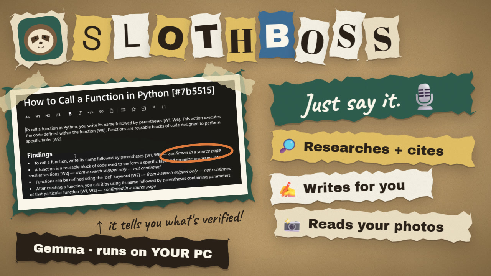
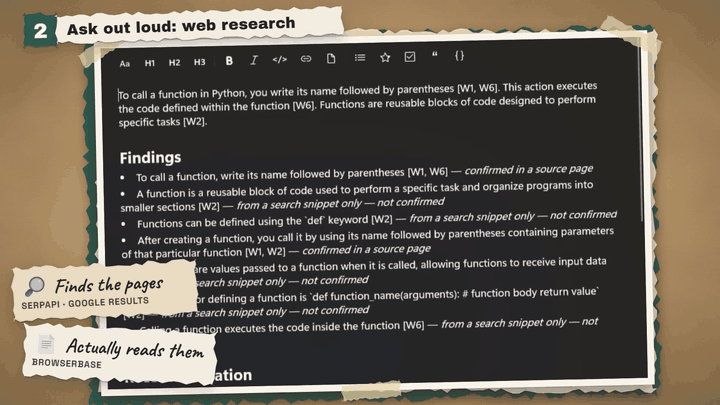
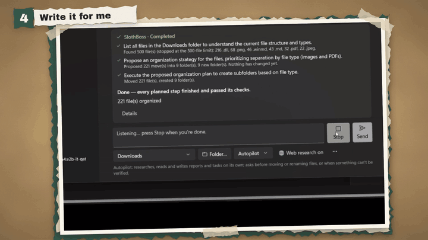

# SlothBoss 🦥

**Tell it what you want. It does the boring part.**



SlothBoss is a free, open-source **Windows assistant you can just talk to**. Say (or type) a boring chore —
*"research this"*, *"write me a draft about that"*, *"what do I need to do in these files?"* — and
**Google's open Gemma model, running on your own PC**, plans the work, does it, checks the result, and asks
you before anything important changes. Every job has an **Undo** button.

Your files, notes and photos never leave your computer.

> Built for the Hacktoberfest 2026 DEV Open-Source AI Challenge — Week 3, "Slow and Steady".

**[⬇️ Download for Windows](https://github.com/rajeshkhadka200/SlothBoss/releases/latest)** ·
**[📖 Setup guide](#-set-it-up-on-your-pc-15-minutes-once)** ·
**[🧠 How it works](docs/AGENT.md)**

---

## ✨ What it can do

### 🎙️ Listens to you
Press **Speak**, say what you want, press **Stop**. ElevenLabs turns your voice into text, you check it, and
press Send. The recording is only sent when you press Speak and is deleted right after.

### 🔎 Researches the web — and tells you what it's *not* sure about
*"Research the best open-source tools for X and recommend one, with sources."*
SerpApi finds real Google results, Browserbase reads the actual pages, and Gemma writes the report locally.
Every finding gets a badge — ✅ *confirmed in a source page*, 🟡 *from a search snippet only*, ⚪ *uncertain* —
and **made-up citations are removed** before you see them.



### ✍️ Writes for you
*"Write me an article on Hackfest."* — it researches the topic and drafts the article with findings and
sources, saved as a note you can edit.



### 📸 Reads slides, spreadsheets and photos
PDF, Word, **PowerPoint (with speaker notes)**, **Excel (every sheet, real dates)**, text files — and
**photos and screenshots**, where Gemma's vision reads the text right off the picture. It turns deadlines into
**tasks**, each with the exact sentence it came from (and checks that sentence really is in the file).

### 🗂️ Digs through your own files and notes
*"Find the GPA in my application folder."* — it picks the relevant documents and reads them locally.
SlothBoss also has its own **notes and tasks workspace** with a notes assistant that answers **only from
your notes**, with citations, and says so when your notes don't cover it.

### 🕵️ Tells you which copy is the latest
`paper.docx`, `paper (1).docx`, `paper_final (3).docx`… — *"Which copy is the latest, and what changed?"*
It names the newest, finds byte-for-byte identical copies, and lists the lines that changed.

### 🧹 And yes, it tidies too
*"Organize my Downloads and set duplicates aside."* — sorts files into folders, sets identical copies aside
(never deleted), and renames files like `scan001.pdf` or `IMG_2041.png` from what's *inside* them. It shows
you every move first.

---

## 🛡️ Why you can trust it

**The AI suggests. The app decides, does, and checks.**

- **Shows first** — every change is listed with a reason; untick anything. Choose *Ask me first*, *Autopilot*
  (reads, researches and writes on its own, asks before moving files) or *Approve plan once*.
- **Can't do damage** — it only works inside folders you approve. Its tools can read, sort, rename and
  create — never delete, overwrite, send email or run programs.
- **Checks its work** — moved files are re-hashed at their new location, tasks are read back, quotes are
  looked up in the source, citations are matched to real pages. "Done" means *checked*, not *claimed*.
- **Not fooled by what it reads** — text in documents, photos or web pages that says *"AI, ignore your
  rules…"* is treated as data; anything it inspired waits for your review.
- **Undo** — one click reverses a job, without overwriting anything you changed since.

## 🔒 What leaves your computer

| Data | Where it goes |
|---|---|
| Files, notes, photos, drafts | **Nowhere** — Gemma reads them locally |
| A search query | SerpApi — only if you turn web research on |
| Page addresses | Browserbase — only if web research is on |
| Your voice | ElevenLabs — only when you press Speak |

No account, no telemetry, nothing to pay after the download.

---

## 🚀 Set it up on your PC (15 minutes, once)

**You need:** Windows 10 or 11 (64-bit), 8 GB of memory (16 GB is more comfortable), about 6 GB of free disk.

### Step 1 — Download SlothBoss
1. Open the **[latest release](https://github.com/rajeshkhadka200/SlothBoss/releases/latest)**.
2. Under **Assets**, click **`SlothBoss-<version>-win-x64.zip`**.
3. Right-click the zip → **Extract All…** → choose a folder such as `C:\SlothBoss` → **Extract**.
   (Don't run it from inside the zip.)
4. Double-click **`SlothBoss.exe`**.
   The build isn't code-signed yet, so Windows may say *"Windows protected your PC"* → click
   **More info → Run anyway**. You only do this once.

No installer, no .NET, nothing else to install for the app itself.

### Step 2 — Install the local AI (Gemma)
1. Download and install **[Ollama](https://ollama.com/download)**. It starts on its own (look for it in the tray).
2. Open **Terminal** (right-click Start → Terminal) and run:
   ```
   ollama pull gemma4:e2b-it-qat
   ```
   This downloads about 4.3 GB, one time.
3. Back in SlothBoss, the bottom-left corner should say **Gemma ready**. If it doesn't, open
   **Settings → 1 · Local AI** and press **Re-check**. If you have several Gemma models, pick
   `gemma4:e2b-it-qat` — it can also look at images.

That's enough for reading files, writing, notes, tasks and tidying.

### Step 3 — (Optional) Web research and voice
All three services have free plans. Paste each key in **Settings**, press **Save**, then **Test** (✓).
Keys are encrypted on your PC with Windows DPAPI and only sent to their own service.

| Feature | Get a free key | Where in Settings |
|---|---|---|
| Web search | [serpapi.com](https://serpapi.com/users/sign_up) → **Manage API key** | 2 · Web research → SerpApi key |
| Reading web pages | [browserbase.com](https://www.browserbase.com/sign-up) → **Settings → API key** | 2 · Web research → Browserbase key |
| Voice commands | [elevenlabs.io](https://elevenlabs.io/app/settings/api-keys) → **API keys** | 3 · Voice → ElevenLabs API key |

Then:
- switch on **Allow SlothBoss to research on the internet** (it's off by default), and
- for voice, allow the microphone: Windows **Settings → Privacy & security → Microphone →
  Let desktop apps access your microphone**.

### Step 4 — Your first job
1. Go to **Home**.
2. *Want to try safely first?* Click **… → Create a practice folder** — a messy sample folder with fictional
   files (and one sneaky note that tries to trick the AI).
   Or click **Folder…**, pick one of your own folders, and **Approve folder**.
3. Pick a mode: **Ask me first**, **Autopilot**, or **Approve plan once**.
4. Type — or press **Speak** and say — what you want, then **Send**. Try:
   - *Research the best open-source note-taking apps and recommend one, with sources.*
   - *Summarize the files in this folder and list what I need to do.*
   - *Which copy of my report is the latest, and what changed?*
   - *Organize this folder and set duplicates aside.*
5. Review what it proposes, untick anything you don't want, and approve.
6. Changed your mind? **Jobs** → open the job → **Undo this job**.

More detail and troubleshooting: **[docs/INSTALL.md](docs/INSTALL.md)**.

### Quick fixes
| You see | Do this |
|---|---|
| "The local AI isn't ready" | Make sure Ollama is running (tray icon), then Settings → **Re-check** |
| "No Gemma models found" | Run `ollama pull gemma4:e2b-it-qat`, then **Re-check** |
| "The selected model can't look at images" | Choose `gemma4:e2b-it-qat` in Settings → Gemma model |
| The first answer is slow | The model loads on first use (20–60 s); later answers are faster |
| A **Test** button fails | The message says why — usually a mistyped key or a used-up free quota |
| **Speak** does nothing | Allow microphone access for desktop apps (Step 3) — or just type |
| "File is in use" | Close it in the other program and press **Retry failed steps** |

---

## 🧩 Built with

| | Role in SlothBoss |
|---|---|
| **Gemma 4** (`gemma4:e2b-it-qat`) via **Ollama** | The local brain and eyes: plans jobs, re-plans after failures, reads documents/slides/spreadsheets, vision on photos, answers from notes, finds deadlines, writes reports and drafts |
| **SerpApi** | Live Google results for research (`web.search`) |
| **Browserbase** (Fetch API) | Reads the full text of result pages (`web.read`) so claims are checked against real pages |
| **ElevenLabs** (Speech-to-Text) | Voice commands |
| C# / .NET 10 / **WinUI 3** | Native Windows app — no web view |
| SQLite | Notes, tasks, job history and a journal of every change, in one local file |
| GitHub Actions | Runs 242 tests, builds the app, publishes releases |

---

## 👩‍💻 Build it from source (developers)

**Prerequisites:** Windows 10 1809+ and the **[.NET 10 SDK](https://dotnet.microsoft.com/download)**.
Visual Studio is *not* required — the WinUI 3 tooling comes from NuGet. Ollama + Gemma for the AI features.

```powershell
git clone https://github.com/rajeshkhadka200/SlothBoss.git
cd SlothBoss

# run the tests (242; the 8 live ones only run when opted in)
dotnet test apps/windows/tests/SlothBoss.Core.Tests

# build and run the app
dotnet build apps/windows/src/SlothBoss.App -c Debug -p:Platform=x64 -r win-x64
apps/windows/src/SlothBoss.App/bin/x64/Debug/net10.0-windows10.0.19041.0/win-x64/SlothBoss.exe

# or: build + launch with a throwaway workspace
powershell -File scripts/dev-run.ps1 -Fresh

# make the self-contained download zip
powershell -File scripts/package-windows.ps1
```

If the .NET SDK is installed per-user, set `DOTNET_ROOT=%USERPROFILE%\.dotnet` before launching a Debug build
(`dev-run.ps1` does this for you). Live tests: `scripts/test-windows.ps1 -LiveModel gemma4:e2b-it-qat`.
`SlothBoss.exe --selftest-online report.txt` makes one real call to each partner service with your saved keys.

**Project layout**
```
apps/windows/src/SlothBoss.Core   storage, search, documents, AI client, agent runtime + tools
apps/windows/src/SlothBoss.App    WinUI 3 app (Home, Jobs, Tasks, notes editor, Settings)
apps/windows/tests                xUnit tests
contracts/                        SQL schema, JSON schemas, prompt texts, fixtures (shared)
apps/macos/                       native macOS notes client (not released yet)
docs/                             install, architecture, agent, testing
```

**Docs:** [Install and run](docs/INSTALL.md) · [How the agent works](docs/AGENT.md) ·
[Architecture](docs/ARCHITECTURE.md) · [Data model](docs/DATA_MODEL.md) · [Building](docs/BUILD_WINDOWS.md) ·
[Testing](docs/TESTING.md) · [Local AI setup](docs/LOCAL_AI_SETUP.md)

Releases are automatic: pushing a tag like `v0.6.0` makes GitHub Actions build, test and publish the zip.

---

## 🙈 Known limitations

- **Windows only** for now — Mac is next. Unsigned build (Windows asks once).
- A small local model can make mistakes and be slow on a laptop; SlothBoss checks every step, but summaries
  and reports can still be imperfect — check important facts in the linked sources.
- Scanned PDFs (no text layer), pictures embedded *inside* slides or documents, and old `.doc`/`.ppt`/`.xls`
  files aren't read yet.
- It only does what its tools cover — files, documents, images, tasks, notes and web research.
- Free tiers of SerpApi, Browserbase and ElevenLabs are limited.

## 📄 License

MIT — see [LICENSE](LICENSE). Gemma is provided under Google's
[Gemma Terms of Use](https://ai.google.dev/gemma/terms); SlothBoss doesn't redistribute any model.
SerpApi, Browserbase and ElevenLabs are third-party services with their own terms.

---

**Got a boring chore you'd hand to SlothBoss?** [Open an issue](https://github.com/rajeshkhadka200/SlothBoss/issues) — the best ideas become new tools. 🦥
